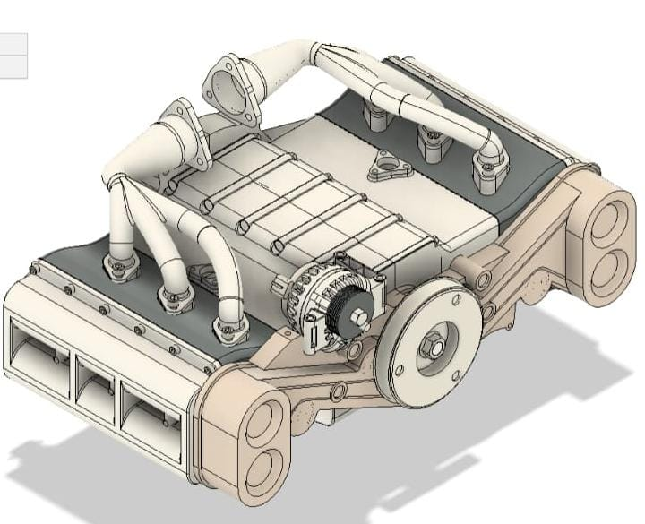
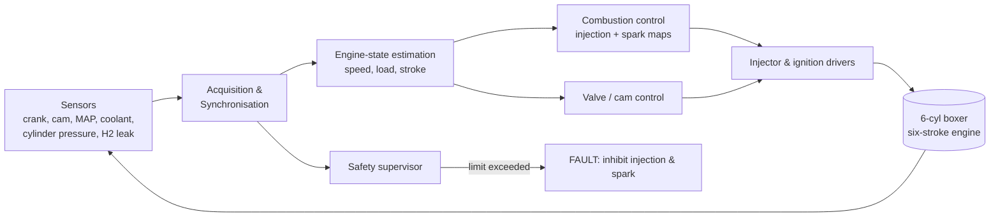

# Hydrogen Six-Stroke ECU — Concept Study

[](#project-status)
[](#project-status)
[](.github/workflows/ci.yml)
[](LICENSE)

A concept-stage engine control unit (ECU) architecture for a **hydrogen-fuelled, six-stroke, horizontally opposed (boxer) six-cylinder engine** with gaseous on-board storage. The ECU is assumed to run on an **NXP S32G-VNP-RDB2** platform. All results in this repository come from **simulation**; no hardware has been built or tested.

<p align="center">
  
</p>

## Headline result (simulated)

| Item | Value |
|---|---|
| Efficiency vs. conventional hydrogen engine (same fuel, gaseous storage) | **> 22 % relative improvement** (simulation, concept stage) |
| Engine layout | Boxer six-cylinder, six-stroke cycle (power in 3rd and 5th strokes) |
| Speed range simulated | 1000 – 5000 rpm |
| Validation status | Not experimentally validated |

See [docs/05_results_summary.md](docs/05_results_summary.md) for the plots behind this and the exact limits of the claim.

## What the ECU concept covers

- Crankshaft / camshaft synchronisation and TDC detection
- Hydrogen injection timing for the two power strokes (end-of-injection map vs. intake pressure and speed)
- Spark timing referenced to MBT, with separate 3rd- and 5th-stroke advance
- Combustion monitoring (peak pressure, peak-pressure position, IMEP, COV)
- Safety supervision (peak-pressure limit, hydrogen leak, thermal and boost limits) with a latched fault state

## Architecture at a glance



Details: [docs/02_system_architecture.md](docs/02_system_architecture.md).

## Repository layout

```
.
├── docs/                    Concept documentation and figures
│   ├── 01_concept_overview.md
│   ├── 02_system_architecture.md
│   ├── 03_control_strategy.md
│   ├── 04_simulation_methodology.md
│   ├── 05_results_summary.md
│   ├── 06_assumptions_and_limitations.md
│   ├── 07_roadmap.md
│   └── assets/              Simulation plots and CAD view
├── ecu_concept/             Reference models (Python, stdlib only)
│   ├── cycle_schedule.py    Six-stroke event schedule (1080° cycle)
│   └── state_machine.py     Supervisory state machine with safety limits
├── config/
│   └── concept_parameters.json   Placeholder parameters (not calibration data)
├── tests/                   pytest unit tests
└── .github/                 CI workflow and issue templates
```

## Quick start

```bash
git clone https://github.com/arunroshan-as/Hydrogen-Six-Stroke-ECU-Concept.git
cd Hydrogen-Six-Stroke-ECU-Concept
pip install -r requirements.txt
pytest -q
python -m ecu_concept.cycle_schedule   # prints the six-stroke event schedule
```

## Project status

| Area | Status |
|---|---|
| Concept definition | Done |
| 0D/1D combustion and control simulation | Done (concept level) |
| ECU supervisory logic (reference model) | Done, unit-tested |
| NXP S32G-VNP-RDB2 target | Assumed, not procured |
| Embedded implementation / HIL / engine bench | Not started — see [roadmap](docs/07_roadmap.md) |

## Important notice

This is a research concept. It is **not** safety-certified, **not** validated on an engine, and **must not** be used to control a real engine or vehicle. Limits and parameters in `config/` are placeholders. Hydrogen systems carry serious fire, explosion and high-pressure hazards and require qualified engineering and regulatory review.

## Citing

See [CITATION.cff](CITATION.cff).

## Author

**Arun Roshan A S**

## License

MIT — see [LICENSE](LICENSE).
