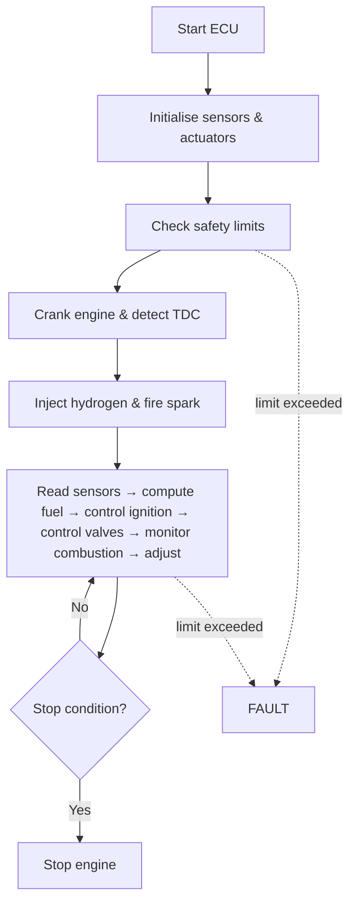

# 02 — System Architecture

## Target platform (assumed)
**NXP S32G-VNP-RDB2** reference design: multi-core ARM application processing with automotive-grade networking, LPDDR4 memory, eMMC storage and M.2 expansion. It is *assumed* as the target because the concept needs concurrent real-time tasks (synchronisation, injection/spark scheduling) alongside heavier combustion-model and diagnostics workloads. The board has not been procured; no firmware targets it yet.

## Functional blocks

| Block | Responsibility |
|---|---|
| Acquisition & synchronisation | Crank/cam decoding, TDC detection, stroke identification across the 1080° cycle |
| State estimation | Engine speed, load proxy (intake pressure), active stroke |
| Combustion control | Look-up of end-of-injection and spark advance; per-power-stroke trims |
| Valve / cam control | Intake/exhaust event control for the six-stroke sequence |
| Combustion monitoring | Peak pressure, peak-pressure position, IMEP, COV |
| Safety supervisor | Limit checks; latches FAULT and inhibits injection and spark |
| Diagnostics / comms | Logging and network interface (CAN/Ethernet class) |

## Task partitioning (concept)

| Layer | Timing class | Examples |
|---|---|---|
| Hard real-time (angle-based) | Per crank-angle event | Injection start/end, spark, synchronisation |
| Soft real-time (time-based) | 1–100 ms | Map interpolation, trims, monitoring |
| Background | ≥ 100 ms | Logging, diagnostics, model-based estimates |

## Control flow

The reference implementation is `ecu_concept/state_machine.py`.
