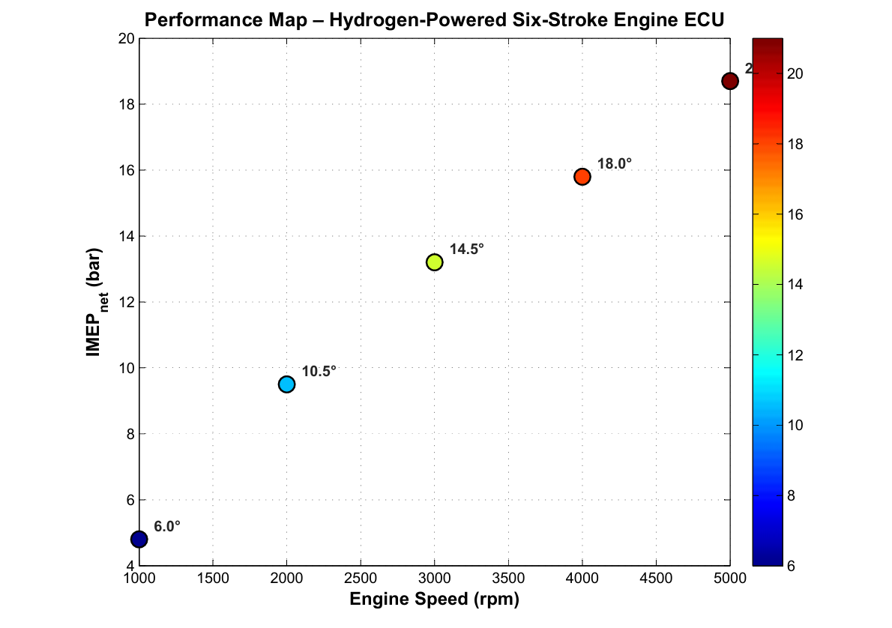
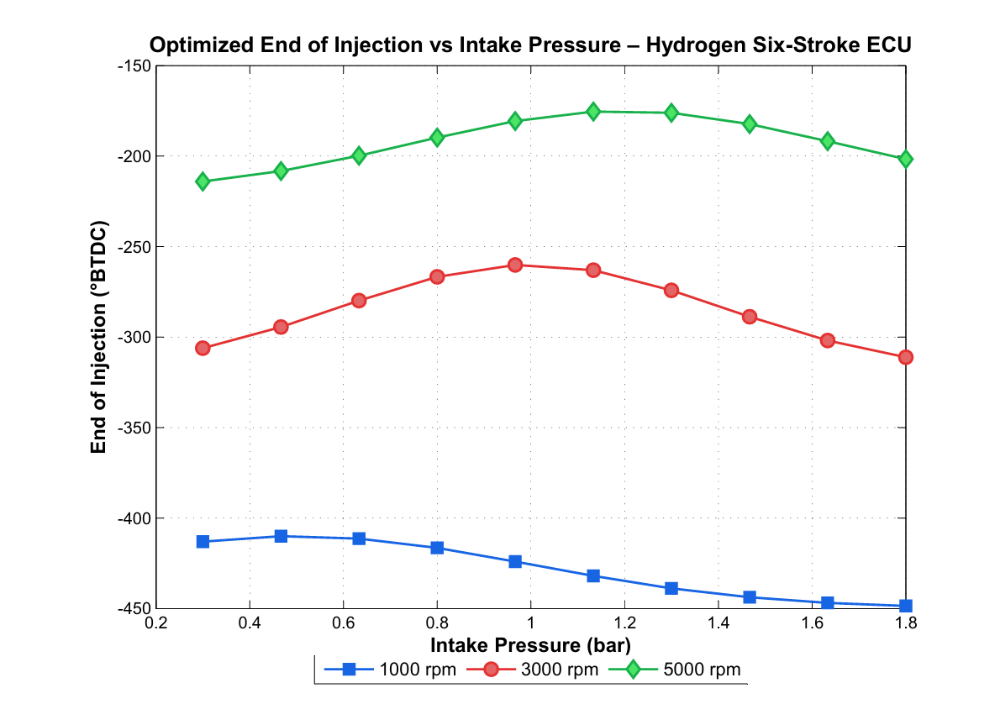
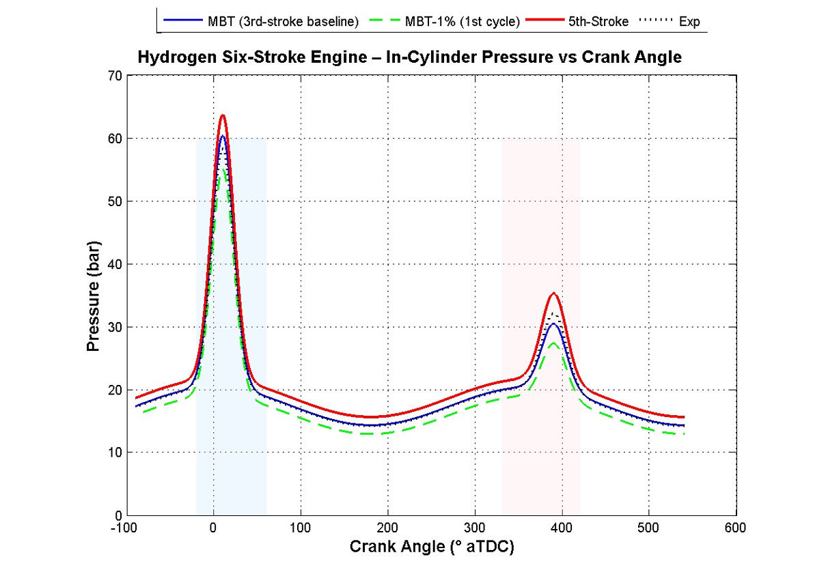
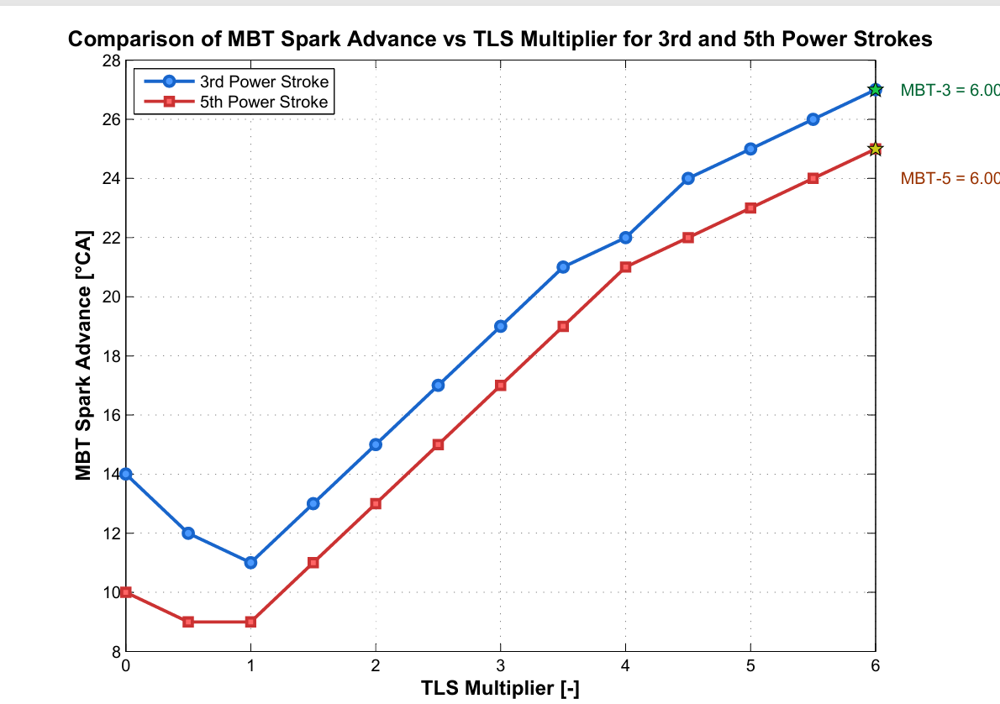
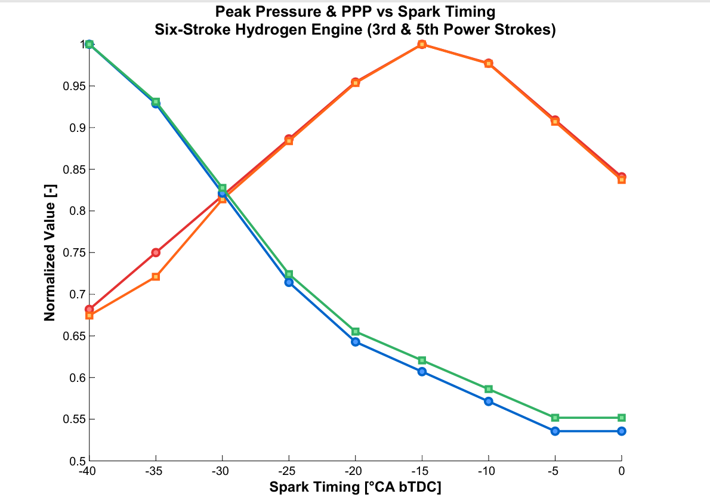
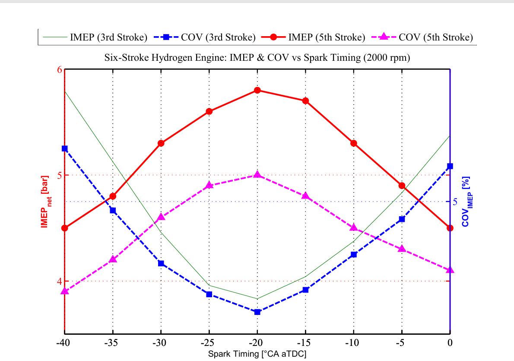

# 05 — Results Summary (Simulation Only)

> All values are read from the plots below and are approximate. Nothing here is experimentally validated.

## Efficiency
The simulated six-stroke hydrogen engine shows a **> 22 % relative efficiency improvement** over a conventional hydrogen engine with gaseous storage. The efficiency basis (indicated vs. brake) and the baseline definition should be stated alongside any citation of this number.

## Figures

### Fig. 1 — Performance map

IMEP rises with speed from about 4.8 bar at 1000 rpm to about 18.7 bar at 5000 rpm, with the colour/annotation showing spark advance (6.0°, 10.5°, 14.5°, 18.0° at 1000–4000 rpm).

### Fig. 2 — End of injection vs. intake pressure

Three speed curves (1000, 3000, 5000 rpm) over 0.3–1.8 bar intake pressure. EOI is far earlier at 1000 rpm than at 5000 rpm.

### Fig. 3 — Pressure vs. crank angle

Two combustion events per cycle. First peak ≈ 55–63 bar depending on case; second peak roughly half of that (≈ 27–35 bar). The MBT−1 % case lowers both peaks. The dotted trace is a reference trace.

### Fig. 4 — MBT spark advance vs. TLS multiplier

A minimum near TLS ≈ 1, then monotonic increase to ≈ 27° (3rd) and ≈ 25° (5th) at TLS = 6. The 5th stroke is lower throughout.

### Fig. 5 — Peak pressure and PPP vs. spark timing

Normalised values: one family falls steadily as spark is retarded, the other peaks near −15°.

### Fig. 6 — IMEP and COV vs. spark timing (2000 rpm)

5th-stroke IMEP peaks (≈ 5.8 bar) near −20°. 3rd-stroke COV is lowest near the same timing, whereas the 5th-stroke COV curve follows the opposite trend (it peaks near −20°); this behaviour has not been explained yet and is flagged for review.

## Interpretation
The trends are physically plausible for a spark-ignited engine, and the separate 3rd/5th-stroke behaviour supports calibrating the two power strokes independently. Evidence of the efficiency gain beyond simulation does not yet exist.
